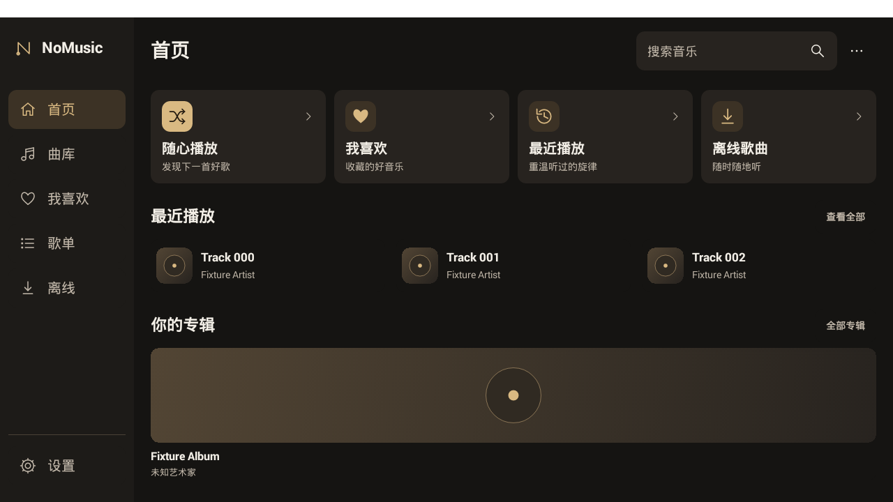

# NoMusic

面向领克 CS11 Android 4.4 的原生 Emby 音乐播放器，最低兼容 Android 4.1（API 16）。使用 Java、原生控件和 MediaPlayer，播放服务独立于界面运行。



界面参考 [fn-music-desktop](https://github.com/guihaiwang/fn-music-desktop)，采用暖炭黑与柔金默认配色、六入口侧栏、曲库分类与专辑网格。首页四个快捷入口随可用宽度和字号自动换行。设置支持深浅外观与六种主题色；播放页默认随封面联动，歌词旁可切换译文。全屏控制条按窗口宽度排布按键，播放／暂停只显示随封面或主题变色的图标。常用触控区为 48 dp，支持标准媒体键。新版 [NoMusic 标志](docs/design/logo.svg) 用于启动图标、登录页和侧栏。

## 下载与安装

当前版本 **0.6.2**，下载站：[nomusic.losertree.de](https://nomusic.losertree.de/)。

| 安装包 | 包名 | 用途 |
| --- | --- | --- |
| [NoMusic-0.6.2-cs11.apk](https://nomusic.losertree.de/downloads/NoMusic-0.6.2-cs11.apk) | com.netease.cloudmusic | 领克 CS11 常见音乐包名兼容版 |
| [NoMusic-0.6.2-standard.apk](https://nomusic.losertree.de/downloads/NoMusic-0.6.2-standard.apk) | com.nomusic.player | 普通安卓设备 |

release 包不可调试，签名沿用 0.1.0，可直接覆盖现有 NoMusic，保留会话、队列和数据。CS11 版与官方网易云包名相同，不能同时安装或覆盖官方签名的应用。

```powershell
adb -s <序列号> install -r app/build/outputs/apk/cs11/release/app-cs11-release.apk
adb -s <序列号> shell am start -n com.netease.cloudmusic/com.nomusic.app.MainActivity
```

0.1.0 没有更新入口，首次需手动安装当前版本；之后可用「设置 → 检查更新」。更新清单按包名分发，客户端验证文件长度、SHA-256、包名、递增版本号和同签名，再由系统确认安装。

## 使用

登录支持 HTTP / HTTPS、反向代理子路径、/emby 和粘贴的 /web/index.html 地址。密码不保存；401 会统一结束旧会话并显示登录页，403 单独提示权限不足。已有下载在登录失效后仍可离线播放。

- **队列**：播放控制条打开侧面队列，可拖动、调序和移除，保持播放及歌词位置；完整管理入口支持插播、追加和清空。
- **外观**：设置 → 显示与歌词，可切换深浅模式、选择暖金 / 落日橙 / 玫瑰 / 青玉 / 雾蓝 / 藤紫。默认“播放页跟随封面”开启，关闭后全屏与迷你播放条使用所选主题色。颜色立即生效并保存，切换颜色保留设置页滚动位置。
- **动画**：进入全屏时轻微上滑淡入，返回时下滑淡出，保留列表位置和歌词阅读位置。首页卡片、按钮、队列和弹窗也有轻量反馈。「设置 → 显示与歌词 → 界面动画」可关闭，也遵循系统动画设置。缓存命中的封面直接显示。
- **整库播放**：首页「随心播放」遍历全库，服务按需补页；列表播放延续当前筛选条件，不限首批 100 首。
- **音频缓存**：完整音频落盘后，在列表歌手名前显示绿色 ✓。播放稳定后逐首缓存当前队列中尚未缓存的歌曲，包括补页进入队列的歌曲；出现缓冲时优先播放。后台预取只用剩余空间，正在播放的新歌需要保存时优先替换最久没听的缓存。查看列表、封面或下载不会改动播放顺序。
- **缓存曲库**：「设置 → 缓存与下载 → 缓存曲库」逐页缓存，跳过已有完整音频，显示首数和占用。可从设置或通知暂停并继续；断网时等待恢复，容量不足时暂停，增大上限后可从断点继续。
- **离线**：歌曲 ⋯ → 下载到离线；离线页分为已下载 / 下载中。本次运行的失败任务可重试、移除。自动缓存与离线下载上限分别为 256 MB–20 GB，支持自定义 MB；默认 256 MB / 2 GB，单曲上限 1 GB，留出 64 MB 可用空间。降低离线上限或自动淘汰不会删除手动下载。
- **断网**：播放按退避从原位置恢复；暂停、切歌、停止和注销会取消旧重连。曲库、封面、歌词和音频下载遇到临时错误最多自动重试两次；登录失效和权限不足直接处理。
- **歌单与曲库**：新建 / 重命名 / 删除歌单及增删歌曲；名称、添加时间、时长排序，流派筛选、文件夹浏览，歌曲 / 专辑 / 歌手综合搜索。
- **歌曲详情**：歌曲菜单查看音频参数，关联跳转专辑、歌手；播放页的专辑名可直接点击。
- **定时**：右上角时钟，选择 15 / 30 / 60 分钟、自定义分钟、播完本曲，可开启最后 8 秒淡出。
- **歌词**：读取独立接口及 Emby 内嵌标签；内存 / 磁盘缓存、滚动、稳定行高与当前行高亮。翻译图标紧邻歌词；手动浏览 5 秒后恢复跟随，也可点「回到当前行」。长按跳进度，歌词 ⋯ 调偏移、字号、本地原文与独立译文、悬浮歌词。有逐字时间的歌词支持逐词高亮。
- **翻译**：开关只控制已有译文，不联网。在线翻译需在设置中配置自己的 LibreTranslate HTTPS 服务，点击「翻译这首歌」才发送歌词并保存译文。
- **播放与恢复**：播放 / 暂停、上下首、进度、随机、顺序 / 列表 / 单曲循环；保存队列、当前索引、进度，重启保持暂停。
- **音质**：「设置 → 播放音质」提供原始流和 MP3 96 / 128 / 192 / 256 / 320 kbps，切换时从当前进度继续。原始格式不可用时尝试 MP3 192 kbps，离线可使用完整缓存。歌曲列表在歌手前显示 SQ、HQ、Hi-Res、DSD 等原文件标识；旧列表缓存联网后会原地补齐。播放页在歌手和专辑之间显示原文件码率，播放档位单独显示在顶部。
- **音效**：播放页顶部滑杆图标或「设置 → 音效」打开均衡器。预设包括平直、温暖、人声和摇滚，有自定义五段及低音增强，调整即时应用，切歌保留。效果可关闭，支持情况取决于设备的音频输出。
- **后台**：前台服务、通知操作、旧式锁屏元数据、焦点丢失 / 恢复 / 压低音量、拔耳机暂停、可选开机打开和屏幕常亮。

封面采用播放服务与界面共享的内存 / 磁盘缓存，同图请求合并，切页和重启可复用。歌曲优先使用服务端提供的歌曲封面；专辑缺图时回退到专辑内歌曲封面。列表按账号、筛选、排序和页码缓存，切换页面保留已加载歌曲与滚动位置；手动「刷新当前页面」可更新曲库。缓存标记在现有列表上就地更新。完整音频再次播放直接复用；截断响应和局部流不会被标作已缓存。

歌词缓存 30 天；确认没有歌词的结果缓存 6 小时；失败不覆盖成功内容，手动刷新位于播放页 ⋯。空白时间点保留在原始歌词中，显示列表直接跳过，不留空行、不补符号；长按可见歌词仍跳转到对应原时间。原文自带符号保留。歌词区省略“歌词”标题和无译文提示，仅用翻译图标表达状态。修改本地歌词不会改写 Emby 标签。纯文本歌词没有同步时间轴；独立纯文本译文需与原文行数一致。

完整行为和限制见 [功能盘点](docs/FEATURES.md)，测试记录见 [0.6.2 验证说明](docs/VALIDATION-0.6.2.md)。

已按 [车机界面设计文档](docs/UI-DESIGN.md) 实施。示例界面使用本地 fixture 数据：[曲库](docs/screenshots/library-light-0.3-fixture.png) · [播放页](docs/screenshots/player-0.3-fixture.png) · [队列](docs/screenshots/queue-0.3-fixture.png)。

## 车机与按键

Android 4.x 使用 AudioManager、RemoteControlClient、ACTION_MEDIA_BUTTON；不依赖 Android 5 才提供的 MediaSession。后台播放不反复抢占其他应用前台。

支持键值 85（播放 / 暂停）、87 / 88（上下首）、86（停止）、126 / 127（播放 / 暂停）、79（耳机键）、89 / 90（前后 15 秒）；音量由系统控制。

CS11 包提供 com.netease.cloudmusic.activity.LoadingActivity、MainActivity、PlayerActivity 启动别名。接收 com.android.music.musicservicecommand 和自身包名的 musicservicecommand，支持 command / cmd 参数 play、pause、togglepause、next、previous、stop。广播 metachanged / playstatechanged，提供标题、艺术家、专辑、进度、时长和数字 id。

CS11 私有按键协议、固件签名白名单、自启动、休眠唤醒仍需实车验证。可用 adb logcat -s NoMusicControls 查看不含令牌的控制日志。

## HTTPS

Conscrypt 2.5.2 提供 Android 4.x 的 TLS 1.2 / 1.3，补充 Let's Encrypt ISRG Root X1 / X2；保持证书链、有效期及主机名校验。 Emby、更新与翻译请求共用同一个 TLS 连接工厂，避免 Android 4.1 按工厂建立的连接池不断累积 socket 和管道句柄。系统通知使用最长边 96 px 的封面副本，锁屏使用最长边 256 px 的独立副本；通知封面发送失败时重建无封面的通知，保留控制按键，界面原图和缓存不受影响。MediaPlayer 通过随机路径的 127.0.0.1 流代理播放，代理支持 Range 并保留完整音频缓存；转码用 StartTimeTicks 跳转。

## 构建与测试

需要 JDK 17+、Android SDK Platform 36 / Build Tools 36，Gradle wrapper 8.14.3 / AGP 8.11.0。支持 ARMv7、ARM64、x86、x86_64；targetSdk 28，用于旧设备侧载。

```powershell
$env:JAVA_HOME='C:/Program Files/Java/jdk-21.0.11'
./tools/build.ps1 -SdkRoot D:/Android/Sdk
./gradlew.bat :app:assembleStandardRelease :app:assembleCs11Release :app:lintStandardRelease :app:lintCs11Release
./tools/test.ps1 -Serial emulator-5556 -Flavor cs11 -Adb D:/Android/Sdk/platform-tools/adb.exe
./tools/test.ps1 -Serial emulator-5556 -Flavor cs11 -Adb D:/Android/Sdk/platform-tools/adb.exe -Features
./tools/test.ps1 -Serial emulator-5556 -Flavor cs11 -Adb D:/Android/Sdk/platform-tools/adb.exe -Ui
./tools/test.ps1 -Serial emulator-5556 -Flavor cs11 -Adb D:/Android/Sdk/platform-tools/adb.exe -Cache
./tools/test.ps1 -Serial emulator-5556 -Flavor cs11 -Adb D:/Android/Sdk/platform-tools/adb.exe -CachePolicy
```

API 16 测试换成 emulator-5554 和 standard。fixture 提供 105 首、可解码音频、歌单、过滤及网络故障模拟；测试在内存中保存并恢复设备原有账号和队列。同一个 fixture 的测试顺序运行。

-SavedLyrics 可只读验证设备已有真实会话的 FLAC / MP3 歌词及缓存；-Live 从 NOMUSIC_TEST_SERVER / NOMUSIC_TEST_USER / NOMUSIC_TEST_PASSWORD 环境变量读取测试凭据。勿把账号和令牌写入源码、发布站或报告。

更新服务部署和签名保留说明见 [tools/updates/README.md](tools/updates/README.md)。

## 参考

- [Embysic](https://github.com/kuangru52/Embysic)：Emby 接口与播放器组织，独立实现 Android 4.x 客户端。
- [StreamMusic / 音流](https://github.com/gitbobobo/StreamMusic)：公开功能和交互说明，未使用其非开源客户端代码。
- [fn-music-desktop](https://github.com/guihaiwang/fn-music-desktop)：侧栏、首页与播放页视觉组织，原生重写，未复制其源码、图标和图片。
- Conscrypt Apache-2.0 及根证书来源见 [THIRD_PARTY_NOTICES.md](THIRD_PARTY_NOTICES.md)。
