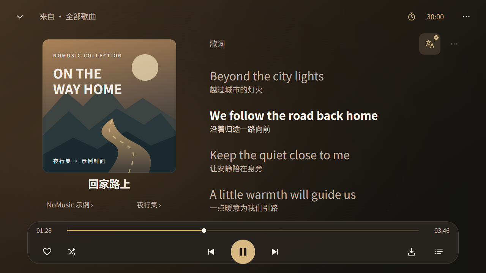
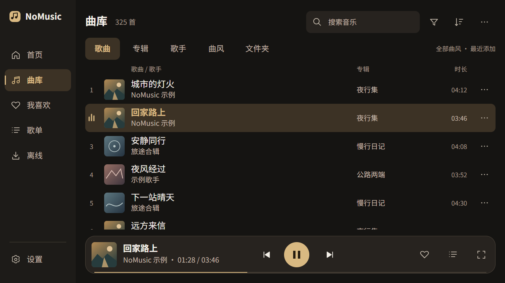

# NoMusic 车机界面设计方案

版本：已确认设计稿 v1，含用户反馈修订 · 日期：2026-11-13 · 原实现基线：NoMusic 0.2.1 / versionCode 3 · 落地版本：0.4.3 / versionCode 10。

**本方案已应用到 NoMusic。** 静态布局图和 fixture 示例图用于说明界面结构，示例不包含真实 Emby 曲库数据。实施和测试范围见 [0.6.2 验证记录](VALIDATION-0.6.2.md)。

## 1. 设计目标与使用场景

以 `img` 中的三张截图为主要视觉依据，结合此前指定的 [fn-music-desktop](https://github.com/guihaiwang/fn-music-desktop) 布局方向，将 NoMusic 整理为两个清晰的使用空间：**曲库负责找歌与管理，全屏播放负责听歌与看歌词。**

| 使用特征 | 本方案的处理 |
| --- | --- |
| 车机上反复操作播放、暂停与切歌 | 核心控制位置固定，提供足够大的触控区，保留标准媒体键 |
| 长时间播放，偶尔短暂查看 | 默认深色，降低背景亮度，突出当前歌词和播放状态 |
| 找歌需要浏览，播放需要聚焦 | 曲库使用侧栏与列表；播放页隐藏曲库结构，封面与歌词分栏 |
| CS11 Android 4.4，硬件与固件能力有限 | 使用现有原生 View、Canvas 与播放服务；静态渐变承担主要氛围效果 |

主要目标：

1. 形成参考图中温暖、克制、有留白的播放氛围。
2. 播放页默认全屏，播放控制持续可见，翻译图标靠近歌词。
3. 歌词滚动、译文显隐与缓存行为一致，常规交互不反复读取服务器。
4. 保留已完成的队列、全库播放、离线、歌单、筛选、定时与更新等能力，并明确入口。

## 2. 参考图分析

三张原图均为 **1298 × 821 px 的桌面截图**，只用于参考视觉和信息组织。车机布局按可用 dp 重新设计。

| 参考 | 可观察到的设计 | 在 NoMusic 中的采用方式 |
| --- | --- | --- |
| A：单语播放页 | 左侧大封面，右侧歌词；封面色延展为暗色背景；当前歌词明亮；底部胶囊播放条；封面下有倒影 | 采用双栏比例、背景取色和当前行聚焦；底部控制增加固定的大触控目标。封面下方优先放置歌曲与关联信息 |
| B：浅色曲库 | 固定侧栏、横向歌曲列表；歌曲与歌手成组；专辑、时长独立成列；选中行有底色；底部悬浮播放条 | 采用列表结构与悬浮播放条，增大行高和字号；专辑、歌手、曲风、文件夹集中为曲库分类，减少侧栏条目 |
| C：双语播放页与菜单 | 与 A 一致的温暖背景；原文下跟随译文；播放控制集中在底部；次要功能收在菜单中 | 原文与译文作为一个滚动单元；翻译显隐改为歌词栏常驻图标；歌词操作与歌曲操作分别就近组织 |

参考图中的窗口标题栏属于桌面环境。实际车机播放页由 Android 全屏窗口呈现；播放器的触控控制持续显示，不依赖鼠标悬停。

设计前已有双栏、歌词缓存和翻译开关；后续按本方案调整背景、视觉层次、比例、控制条与功能入口，并加入主题选择和队列侧面板。

## 3. 页面结构与导航

### 3.1 曲库侧栏

侧栏保留六个一级入口，采用图标加文字；“设置”固定在底部。

| 一级入口 | 页面内容 |
| --- | --- |
| 首页 | 随心播放、我喜欢、最近播放、离线歌曲快捷入口；最近歌曲与专辑 |
| 曲库 | 歌曲 / 专辑 / 歌手 / 曲风 / 文件夹五个分类 |
| 我喜欢 | 收藏歌曲及当前筛选、排序 |
| 歌单 | 歌单列表、歌单详情、新建与管理 |
| 离线 | 已下载、下载中、存储管理 |
| 设置 | 播放、显示与歌词、缓存与下载、账号、版本更新 |

“最近播放”放在首页；专辑、歌手从一级导航移入曲库，关联跳转仍能直接到达详情页。“播放队列”从两种播放条直接打开，与服务器歌单明确区分。

### 3.2 进入播放与返回规则

- 首次登录、没有恢复队列时进入首页；从歌曲、专辑或歌单开始播放后进入全屏播放页。
- 冷启动且存在恢复队列时展示全屏播放页，沿用现有的暂停恢复规则。
- 点击曲库播放条的封面、歌曲信息或展开图标，进入全屏播放页。
- 点击左上收起图标或按返回，回到进入前的页面，保留分类、搜索、筛选、已加载歌曲和滚动位置。
- 全屏进入时上滑 18 dp 并淡入，约 220 ms；收起时下滑并淡出，约 180 ms。关闭界面动画或系统动画时立即切换。
- 队列面板或菜单打开时，返回先关闭当前层；再返回才收起播放页。
- 应用从后台恢复时回到离开前的页面。方向盘或通知切歌更新当前状态，不主动改变所在页面、不抢占其他应用前台。
- 从歌曲信息进入专辑或歌手详情后，返回恢复原来的播放页和歌词位置。

所有页面共用现有播放服务。页面切换只改变显示，不重新创建播放会话。

## 4. 视觉规范

### 4.1 颜色与主题

默认使用温暖的炭黑色曲库，以柔和金色作为基础强调色。设置提供暖金、落日橙、玫瑰、青玉、雾蓝、藤紫六种颜色，每种分别配置深、浅模式的强调色与柔和选中底色。选择后立即保存，保留设置页位置。

“播放页跟随封面”默认开启：播放背景从封面提取低饱和颜色，播放按钮、控制图标、进度、译文选中态与焦点使用相同封面色相。缺少封面或关闭联动时使用所选主题色；迷你播放条同样遵循该设置。参考 B 的浅色曲库可手动切换，播放页在两种曲库外观下均保持暗色氛围。

按钮取色基于封面采样的 HSV：饱和度上限 0.5，深色明度 0.93，浅色明度 0.45，选中底色混入相同强调色。下表 HEX 为基础主题令牌，播放相关强调色随封面替换。

| 令牌 | 深色 | 浅色 | 用途 |
| --- | --- | --- | --- |
| `bg` | `#151412` | `#F7F6F3` | 页面底色 |
| `panel` | `#1D1B18` | `#EFEDE8` | 侧栏、分组区域 |
| `surface` | `#27231F` | `#FFFFFF` | 悬浮条、菜单、对话框 |
| `surfaceRaised` | `#322D27` | `#E8E3DB` | 按下、悬浮层内部强调 |
| `border` | `#494137` | `#D4CEC4` | 装饰分隔线；不单独承担控件识别 |
| `textPrimary` | `#F4F0E8` | `#26231F` | 标题、歌曲名、主要操作 |
| `textSecondary` | `#C2B8AA` | `#625C53` | 歌手、专辑、说明 |
| `textMuted` | `#A69B8C` | `#6B6256` | 时长、数量等辅助信息 |
| `accent` | `#D9B982` | `#805B2E` | 主按钮、选中状态、焦点 |
| `accentSoft` | `#3C3225` | `#EDE0CD` | 选中行、已开启的翻译图标背景 |
| `onAccent` | `#241B10` | `#FFFFFF` | 实心强调按钮上的图标或文字 |

深色语义色：等待 / 警告 `#F0C674`，失败 / 删除 `#F08F82`，完成 `#AFC898`。语义色只出现在对应图标和状态说明中，不作为大面积页面背景。

普通文字对比度目标 ≥ 4.5:1；大字与非文字控件边界 ≥ 3:1；当前歌词目标 ≥ 7:1。选中与错误状态同时使用图标、底色或文字表达，避免只靠颜色区分。

### 4.2 字体与排版

使用设备系统 `sans-serif` 及中文回退字体，不下载字体。使用常规与粗体两档，不依赖 Android 4.x 缺少的字体权重。

| 场景 | 默认字号 | 参考行高 / 规则 |
| --- | --- | --- |
| 页面标题 | 28 sp，粗体 | 36 dp |
| 当前歌曲标题 | 28 sp，粗体 | 36–40 dp，最多两行，触发高度重排 |
| 歌曲列表标题 | 22 sp | 28–30 dp，单行省略 |
| 歌手、专辑、正文说明 | 18 sp | 24–28 dp |
| 侧栏与主要按钮 | 20 sp | 28 dp |
| 数量、时长、分组说明 | 16 sp | 22–24 dp |
| 歌词原文 | 30 sp | 40 dp，所有行字号一致 |
| 歌词译文 | 20 sp | 28 dp，与原文间隔 6 dp |

歌词字号预设为 26 / 30 / 34 sp，译文字号对应 18 / 20 / 22 sp。已有自定义字号在升级时优先保留；预设是新的快捷选择，不强制覆盖旧设置。正文左对齐，时长右对齐，封面下的歌曲信息居中。

文字使用 sp，容器使用 dp。表中行高是默认字体倍率下的参考值；系统大字号时由字体实际高度增大容器，禁止通过裁切或强制缩小文字维持固定行高。

### 4.3 间距、形状与图标

- 基础间距为 8 dp；常用值为 8 / 16 / 24 / 32 / 48 dp，组间距离大于组内距离。
- 页面左右安全留白默认 24 dp；车机系统栏与实车遮挡区另行扣除。
- 列表选中行、按钮圆角 12 dp；封面圆角 16 dp；悬浮播放条圆角 24 dp。
- 弹窗使用 20 dp 圆角表面，清除 Android 4.x 默认窗口与内部面板的黑框、标题分隔线；按钮至少 56 dp 高，颜色与当前主题联动。
- 图标采用统一线条风格，主体 24–28 dp、约 2 dp 线宽；用现有 Canvas 图标体系扩展。
- 全屏常用按键为 **48 × 48 dp**，进度条区域高 40 dp；迷你播放条常用按键宽 48 dp、高 56 dp，主播放键为 56 × 56 dp。
- [品牌标志](design/logo.svg) 用一笔连续的波形构成 N，适配小尺寸。启动图标使用多密度 PNG，登录和侧栏使用同一图形。
- 表单与菜单项至少 56 dp 高。歌词长按行至少 64 dp 高，按实际文字内容扩展。
- 触控按下用实色底变化；方向键焦点使用 2 dp 清晰描边，与播放中 / 选中状态独立。

## 5. 全屏播放页

上图为初版 1280 × 720 的静态设计示意；可编辑源文件：[player.svg](design/player.svg)。实际实现按 dp 布局、sp 排字。

### 5.1 基准布局

坐标以扣除系统保留区后的可用内容左上角为原点，默认字体倍率为 1.0。

| 区域 | 1280 × 720 dp 下的位置与尺寸 | 内容 |
| --- | --- | --- |
| 顶部栏 | `x=24, y=16, w=1232, h=56` | 左侧收起与播放来源；右侧播放档位、音效、定时和歌曲更多 |
| 左侧封面 | `x=112, y=104, w=352, h=352` | 方形封面，16 dp 圆角 |
| 歌曲信息区 | `x=88, y=464, w=400, h=96` | 歌曲标题；歌手、原文件码率、专辑 |
| 歌词区 | `x=552, y=88, w=672, h=500` | 工具栏与歌词滚动视口 |
| 悬浮控制条 | `x=180, y=600, w=920, h=104` | 上排 40 dp 时间与进度；下排 56 dp 播放操作和 8 dp 底部留白 |

标题换为两行或系统字体放大时，封面按剩余高度缩小。歌手与专辑各自有 48 dp 高的触控区域，文字过长省略；缺少关联信息时收起对应入口。码率取自原文件，来源未知时省略。

### 5.2 背景与封面

1. 沿用封面缓存；从低分辨率缩略图提取代表色，颜色结果随封面缓存复用。
2. 将饱和度限制在约 10%–35%，HSL 亮度控制在 8%–18%，生成左暖右暗的静态渐变。
3. 歌词后方叠加深色遮罩；阅读区域合成后的相对亮度上限为 0.05，并按实际文字颜色检查对比度。
4. 封面变化时只进行一次 180–240 ms 淡入；解码失败或没有封面时使用统一的原生绘制占位图与暖黑背景。

歌词的远近层次通过文字颜色、字重和视口边缘遮罩表现。中间阅读区的普通歌词保持可读；边缘渐隐只作用于即将离开视口的内容。首版不需要实时背景模糊、歌词模糊或连续倒影渲染。

### 5.3 控制条与操作分组

控制条保持显示，采用半透明深色实底和轻描边。上排为已播时间、进度条、总时长，拖动时展示目标时间，释放后跳转；缓冲与用户拖动分别显示，等待网络时不假装进度前进。

下排左侧为收藏与播放模式，中间为上一首 / 播放暂停 / 下一首，右侧为离线下载与播放队列。主播放键无底色，图标随封面或主题变色，方向键焦点有描边。播放模式按钮打开顺序、列表循环、单曲循环与随机设置，并显示当前状态说明。

下排按控制条实际测量宽度排列七个独立触控区。空间不足时先收起收藏与下载，再减小切歌间距；最窄布局保留上一首、播放、下一首和队列。320–1280 dp 布局检查所有可见按钮均处于容器内且互不重叠。

- 顶部时钟：打开定时停止；启用后在同一位置显示剩余时间或“本曲结束”。
- 顶部音质和音效：宽屏显示播放档位，窄屏可在歌曲更多中切换。滑杆图标打开音效面板，提供预设、自定义和低音增强。
- 顶部歌曲更多：歌曲信息、专辑 / 歌手、加入歌单及歌曲操作。
- 底部下载：未下载时提供下载动作，下载中显示进度，已下载用完成标记；完整操作位于歌曲菜单。
- 收藏、下载和歌单写入失败时恢复真实状态，并给出一次说明。离线情况下保留可用的本地播放操作。

播放与暂停按钮在缓冲期间仍然可操作；用户暂停会取消重连，按钮与状态文案同步变化。

## 6. 歌词与翻译

### 6.1 翻译图标的位置和状态

翻译按钮从当前页面总工具栏移到**歌词栏右上角**，紧邻歌词更多按钮。基准位置为 `x=1104, y=88, w=56, h=56`；歌词更多为 `x=1168, y=88, w=56, h=56`。响应式布局中始终依附歌词栏，不固定在物理屏幕坐标。

图形使用统一的“文 / A”翻译符号，绘制在 Canvas 中；不再使用大块文字按钮。歌词工具栏省略“歌词”标题，保留右侧图标位置与左侧弹性空间。

| 数据状态 | 图标表现 | 交互与语义 |
| --- | --- | --- |
| 有译文，显示中 | 封面强调色图标、同色系浅底、小勾标记 | 点击隐藏；描述“隐藏歌词翻译” |
| 有译文，已隐藏 | 普通描边图标，无选中底 | 点击显示；描述“显示歌词翻译” |
| 没有译文 | 图标减弱并带不可用标记 | 不可切换，仅无障碍描述“本曲没有译文”；保留其他歌词操作，不显示无译文提示文字 |
| 尚在加载 | 位置保留，暂不可切换 | 缓存解析完成后一次性更新 |

保留现有的译文显隐偏好；当前歌曲没有译文不改变该偏好。显隐开关只控制已有译文，不发起网络翻译。

### 6.2 滚动与时间轴

- 原文与译文绑定为一个歌词单元，译文紧跟对应原文，不能分别滚动。
- 当前原文使用明亮暖白色与粗体，其他行使用可读的暖灰色；行激活前后字号不变，避免列表高度跳动。
- 默认将当前原文基线定位在歌词视口高度约 38% 处；长行换行时按完整单元的实际高度计算。
- 正常跟随用约 240 ms 平滑滚动；拖进度、跨段跳转和缓存首次恢复直接定位，避免长距离滚动。
- 手动滚动暂停跟随；显示至少 56 dp 高的“回到当前行”按钮。最后一次触摸结束后 5 秒恢复；按住屏幕时不抢回位置。
- 长按带时间的歌词跳到该段；普通点击不触发跳转。纯文本歌词保持手动阅读，并说明“纯文本歌词”。
- 译文开关或字号变化后，以当前歌词单元重新计算高度；自动跟随时保持当前行锚点，手动浏览时保留浏览单元及其相对位置。
- 有逐词时间数据时在当前原文内部逐词高亮；数据缺失时采用整行高亮。
- 带时间戳的空白歌词保留在原始数据中，显示时过滤空行；间奏保持前一句高亮，可见行跳转仍使用原时间，不补音符。原文已有符号原样保留。
- 用户发起在线翻译时只发送非空原文，空时间点保留在结果中；连续空白批次不请求翻译接口。

“回到当前行”显示在歌词工具栏的弹性空间中，始终给翻译与更多按钮保留位置，不遮挡当前行。

### 6.3 缓存与增强入口

沿用现有缓存策略，不因换页或重绘改变数据生命周期：

1. 用服务器、账号与歌曲组成缓存键；进入播放页先读内存，再异步读磁盘，命中后立即展示。
2. 成功歌词缓存 30 天，明确无歌词的结果缓存 6 小时；失败不覆盖已有成功内容。
3. 当前歌曲的歌词请求合并；进度更新、翻译显隐、调字号、调偏移、打开队列、返回同一播放页均不重复请求未过期歌词。
4. 过期缓存仍可先显示，后台按需刷新；刷新失败保留缓存内容，不清空歌词或重置滚动。
5. 切歌或账号变化时校验回调所属的歌曲和会话，旧结果不能写入新页面。手动下载继续预取并保留歌词。

歌词更多菜单分组：

| 分组 | 功能与说明 |
| --- | --- |
| 显示 | 字号、悬浮歌词开关；偏移有值时显示当前值 |
| 同步 | 逐曲 ±10 秒偏移，100 ms 步进，提供重置；正数让歌词提前 |
| 内容 | 编辑本地原文、编辑独立译文、手动刷新歌词 |
| 在线翻译 | “翻译这首歌”；未配置时进入翻译服务设置，明确这是联网操作 |

歌词编辑保存在本地覆盖层，不改写服务器标签。常规播放时不常驻显示缓存期限、来源解析过程等细节；离线使用旧缓存或刷新失败时，用一次简短说明反馈。纯文本、缺少译文和无歌词分别表达，不能统一显示为“加载失败”。

## 7. 曲库与首页

上图为默认深色曲库的静态设计示意；可编辑源文件：[library.svg](design/library.svg)。浅色主题沿用同一结构与尺寸，只替换颜色令牌。

### 7.1 基准布局

| 区域 | 1280 × 720 dp 下的位置与尺寸 | 说明 |
| --- | --- | --- |
| 侧栏 | `x=0, y=0, w=192, h=720` | 图标加文字；当前页有底色和定位标记 |
| 页面头部 | `x=216, y=24, w=1040, h=64` | 标题、数量、搜索、筛选、排序、页面更多 |
| 曲库分类 | `x=216, y=96, w=1040, h=56` | 歌曲、专辑、歌手、曲风、文件夹 |
| 列标题 | `x=216, y=160, w=1040, h=32` | 歌曲、专辑、时长 |
| 列表视口 | `x=216, y=192, w=1040, h=392` | 默认 72 dp 行高，约五个完整歌曲行 |
| 曲库悬浮播放条 | `x=216, y=600, w=1040, h=96` | 64 dp 封面、当前歌曲、核心控制、队列、展开 |

列表内容区在播放条上方结束，保留 16 dp 间隔，不把歌曲或菜单藏到悬浮条背后。没有当前歌曲时播放条收起，内容区扩展。

### 7.2 列表与筛选

歌曲行包含：播放状态 / 序号、52 dp 封面、歌曲名与歌手、专辑、时长、更多。宽布局中专辑列参考 192 dp，时长 72 dp，更多 56 dp，主要列间距 16 dp；歌曲文字列弹性填充。

- 点击歌曲开始播放并进入全屏；更多按钮与长按提供相同的歌曲操作。
- 当前播放行同时显示播放符号、选中底色和歌曲名强调；键盘焦点独立描边。
- 只在歌手名前显示音质短标签。SQ 为无损、HQ 为至少 256 kbps 的已知有损编码、Hi-Res 为 24 bit 且至少 48 kHz 的无损、DSD 单独标记；信息不足时留空。标签与完整音频的绿色勾可同时显示。
- 标题显示服务端总数；分页等待显示在列表末尾，失败可以重试并保留已加载内容。
- 筛选与排序分开提供入口。当前流派、排序及搜索词有明确说明；存在筛选时出现“清除筛选”。
- 名称升降序、添加时间、时长沿用现有能力；列表播放与继续加载保持当前筛选条件。
- 搜索按钮展开搜索输入，提交后展示歌曲 / 专辑 / 歌手结果分类；进入详情或播放再返回时保留搜索上下文。
- 专辑与歌单以封面网格展示，宽布局每行约 4–5 项；歌手采用统一头像区域，缺图时保持占位尺寸。
- 文件夹页面显示当前位置和逐级返回；曲风分类选择后进入带筛选说明的歌曲列表。

### 7.3 首页与曲库播放条

首页四个快捷入口使用统一中性卡片，左上角为 44 dp 图标底座与正常尺寸的本地 Canvas 图标；“随心播放”的底座使用实心强调色，其余为柔和底色。下方使用 20 sp 标题和 14 sp 简短说明，右上箭头提示可进入。卡片内边距 16 dp、间距 12 dp，保留键盘焦点与按下反馈，不使用透明度降低文字清晰度。

卡片按实际可用宽度和系统字号在 4 / 2 / 1 列间调整，不压缩或拉伸图标。下方依次是最近播放和专辑，整页可以滚动；无历史时给出前往曲库的明确动作。

“随心播放”从全库建立连续播放来源，界面说明“全库随机 · 自动继续加载”；沿用现有分块打乱与补页机制，不将首批数据展示为整库已完成加载。

曲库悬浮条保留封面、歌曲名、歌手、时间、上下首、播放暂停、收藏、队列和展开入口。底缘细进度仅用于状态展示；精确拖动在全屏播放页完成，避免与紧邻按钮形成重叠触区。歌曲信息区整体可点击展开。

## 8. 队列、歌单与歌曲信息

### 8.1 播放队列

从播放条打开右侧队列面板，宽布局参考宽 520 dp，顶部与底部不覆盖公共播放控制。面板标题为“播放队列”，显示已加载数量和来源；存在后续页时说明“将继续加载”。

每行包含拖动柄、歌曲与歌手、当前播放标记、更多。拖动柄触区至少 56 dp；更多菜单提供上移、下移、移除，供触控以外的输入使用。“下一首播放”和“加入队列末尾”位于歌曲菜单。

- 拖动和删除其他歌曲保留当前歌曲实例与播放进度；重复歌曲作为不同队列条目处理。
- 删除当前条目后选择其后的条目；若删除的是末项，则选择剩余末项。原来正在播放时按现有服务逻辑开始下一条，暂停时保持暂停。
- 队列清空并且没有可继续加载的歌曲时停止播放，显示前往曲库的入口。
- 队列更多可进入完整管理页及现有清理操作。点面板外、关闭按钮或返回收起；关闭后焦点回到队列按钮。
- 面板开放期间，焦点限定在面板和公共播放控制内，标准媒体键继续有效。

### 8.2 歌单

歌单页右上提供“新建歌单”；详情页提供播放、随机播放与更多管理。新增、重命名使用带当前值的表单；歌曲菜单提供“加入歌单”，选择列表内可新建。

移除歌曲写为“从歌单移除”；删除歌单先展示名称和确认，说明歌曲仍在曲库中。权限不足提示“当前账号不能修改此歌单”，保留登录与当前播放。提交期间禁用重复提交，不提前把失败的写操作显示为成功。

### 8.3 歌曲信息与关联跳转

歌曲信息面板优先展示封面、名称、歌手、专辑；歌手与专辑是明确可点击的关联行。音频编码、采样率、位深、声道、码率、大小、年份与流派放在可滚动的“音频信息”区域，缺失字段用“未知”或省略处理。

播放页上的歌手和专辑提供直达入口；多个关联歌手时打开选择列表。离线且关联数据未缓存时说明“联网后查看”，保持本地播放可用。

## 9. 离线、网络与账号状态

### 9.1 离线与存储

离线页分“已下载”和“下载中”，头部展示已下载歌曲数与存储占用。下载中逐项展示进度、取消、失败重试；已下载项提供播放与移除本地文件。

存储管理区明确区分：

| 类型 | 默认上限与呈现 | 清理操作 |
| --- | --- | --- |
| 自动音频缓存 | 默认 256 MB，可调 256 MB–20 GB，支持自定义 MB；播放稳定后优先缓存当前歌曲和队列；按最近实际播放时间淘汰 | 上限选择、“清除自动音频缓存” |
| 缓存曲库 | 设置显示已处理 / 总首数及自动缓存占用；播放缓冲与断网期间等待，满额暂停 | 开始、暂停、继续，通知内也可暂停 |
| 手动离线下载 | 默认 2 GB，可调 256 MB–20 GB；单曲上限 1 GB；降低上限保留已有下载 | 上限选择、按歌曲移除 |
| 歌词与本地编辑 | 跟随现有按账号保存规则 | 歌词刷新与编辑重置从歌词菜单操作 |

有完整缓存或下载的歌曲在歌手名前显示绿勾。短标记不占新行，无障碍读出“已缓存”。缓存状态变化或旧曲库音质补齐时就地更新可见行，保持滚动、焦点和封面。整个曲库进程结束后按账号保存任务进度；未完成的单首会从头重新下载。

“清理自动缓存”和“删除已下载歌曲”使用不同名称与说明。退出账号保留下载文件的既有规则在账号页说明；登录失效时允许打开现有账号的离线歌曲。

### 9.2 状态反馈

| 状态 | 视觉呈现 | 可用动作 |
| --- | --- | --- |
| 首次加载曲库 | 保留页面头部，列表区显示单个加载提示或静态占位 | 返回、切换页面 |
| 分页失败 | 保留已加载项，末尾显示“加载失败，重试” | 重试、播放已有歌曲 |
| 音频缓冲 | 播放条显示等待状态，时间保持真实 | 暂停、切歌、打开队列 |
| 断网等待恢复 | 一条稳定状态“网络中断，等待恢复”；按服务状态更新重试说明 | 暂停取消恢复、切歌、进入离线 |
| 已有完整本地音频 | 短暂提示“正在离线播放”，随后保留小型离线标记 | 正常本地播放 |
| 歌词刷新失败但有缓存 | 保留歌词与当前行，提示一次“已使用缓存歌词” | 继续阅读、手动刷新 |
| 确认没有歌词 | 歌词区域显示“暂无歌词” | 歌词编辑、歌曲信息 |
| 登录过期 / 401 | 统一进入“登录已失效”页面，一次说明，不叠加多个弹窗 | 重新登录、打开离线歌曲 |
| 权限不足 / 403 | 就地提示具体操作权限不足 | 关闭提示，继续其他操作 |
| 更新检查失败 | 手动检查显示可重试结果；自动检查安静结束 | 手动重试 |

持续错误使用稳定状态区，避免每次重试都弹出提示。网络恢复后从服务实际恢复的时间继续；用户暂停、停止、切歌或注销后，旧重连不能再次改变界面。

登录表单沿用服务器地址、用户名、密码；字段至少 56 dp 高，提交期间给出结果。失效时保留可复用的服务器地址与用户名，不把密码或令牌展示在界面、设计图或日志中。

## 10. 定时停止与设置、更新

### 10.1 定时停止

点击播放页时钟，提供 15 / 30 / 60 分钟、自定义、播完本曲、关闭计时；自定义范围沿用 1–720 分钟。“最后 8 秒淡出”单独作为选项。

启动后时钟旁显示剩余时间；选择播完本曲时显示“本曲结束”。修改即时反馈，关闭后回到普通时钟图标。触发后暂停并保留队列，显示一次“已按定时设置停止”。

### 10.2 设置分组

| 分组 | 内容 |
| --- | --- |
| 播放 | 优先原始音质、定时停止、停止播放 |
| 显示与歌词 | 屏幕常亮、外观模式、主题颜色、播放页跟随封面、界面动画、歌词字号、悬浮歌词、翻译服务 |
| 缓存与下载 | 自动缓存开关、可调上限、缓存曲库与进度、清理、离线歌曲入口 |
| 车机与账号 | 开机打开、账号信息、退出账号；包类型与适配详情收在说明中 |
| 关于与更新 | 当前版本、检查更新、自动检查开关、更新记录 |

每组使用标题与留白分隔；开关整行可点击，状态明确。长文本与高级信息在滚动区域内，不挤占播放控制。

### 10.3 应用更新

继续使用已部署的 [nomusic.losertree.de](https://nomusic.losertree.de/) 更新服务器和按包名分发的清单，本设计不改变服务器部署。

更新入口位于“设置 → 关于与更新”。状态顺序为：待检查 → 检查中 → 已是最新版 / 发现新版本 → 下载中 → 校验中 → 安装就绪 → 系统安装器。

- 发现新版本时显示版本号、更新内容、文件大小，以及“下载更新”“稍后”。
- 下载时显示已下载大小、总量与进度；校验阶段明确等待，尚未校验通过不能安装。
- 沿用长度、SHA-256、包名、递增版本与同签名校验；校验失败用可理解的说明和重试入口，详细原因放在展开区域。
- 系统完成安装后展示实际安装版本；自动检查每天最多一次，不用阻塞播放的弹窗提示更新。
- CS11 与标准版显示各自包类型，客户端下载匹配安装包；技术字段放在详情中，不要求用户自己选择 APK 包名。

## 11. 屏幕适配、焦点与性能

### 11.1 逻辑尺寸

以可用逻辑宽高 `W × H` 为条件，不直接按物理像素判断。

| 条件 | 曲库 | 播放页 |
| --- | --- | --- |
| `W ≥ 1100` 且 `H ≥ 640` | 192 dp 侧栏，完整专辑列，96 dp 播放条 | 约 40% / 60% 双栏，封面按剩余高度缩放，128 dp 控制条 |
| `W ≥ 900` 且 `H ≥ 540`，未满足上一档 | 160 dp 侧栏，专辑并入副标题，隐藏独立专辑列 | 双栏缩小封面至约 240–288 dp，优先保留歌词宽度 |
| `W ≥ 800` 且 `H ≥ 480`，未满足前两档 | 80 dp 图标加短标签侧栏，歌曲与歌手两级列表 | 小封面与歌词双栏，封面约 176–216 dp；次要操作进入更多 |
| 其余尺寸，或字体放大后双栏无法容纳 | 可收起导航，列表继续滚动 | “封面 / 歌词”两种视图切换，共用固定播放控制 |

所有尺寸均先扣除系统栏与实车保留区。控制条高度根据触控目标和文字实际高度计算，缩小屏幕时优先压缩封面、留白和次要信息，核心触控目标不缩小。

已知验证环境：API 19 为 1280 × 720 px / 160 dpi；API 16 为 1920 × 1080 px / 240 dpi，两者逻辑尺寸约为 1280 × 720 dp。实际 CS11 的可用高度、密度、系统栏和边缘遮挡仍需实车确认。

### 11.2 输入与焦点

- D-pad 按屏幕空间顺序移动，中心键执行当前操作；菜单关闭后恢复发起控件的焦点。
- 播放页初始焦点放在播放 / 暂停按钮；不自动聚焦搜索框或弹出键盘。
- 标准播放 / 暂停、上下首、停止与快进退键沿用播放服务；按钮改版不能改变广播和媒体按键接收链路。
- 所有图标都有动态 `contentDescription`，包括“隐藏歌词翻译”“取消下载”“播放模式：列表循环”等状态。
- 长按、拖动均有菜单等价操作。当前播放状态、键盘焦点与按下状态分别表达。

### 11.3 Android 4.x 落地

- 使用 `GradientDrawable`、`StateListDrawable`、原生列表与 Canvas；圆角封面通过兼容 API 16 的裁剪 / Drawable 实现。
- 静态背景颜色随歌曲封面更新一次，退出页面释放临时位图；封面采样、缓存读取及颜色提取放在后台线程。
- 歌词进度更新只修改必要行的高亮与滚动；保留列表复用，避免按每个进度回调重建页面。
- 过渡使用短暂的属性动画；设置 → 显示与歌词 → 界面动画可关闭。系统 Animator 时长为 0 时同步停用。背景没有持续动画。API 19 使用沉浸式全屏，API 16 按系统能力保留必要导航区域。

0.4.2 动画参数：

| 交互 | 效果 | 时长 |
| --- | --- | --- |
| 首页快捷卡片 | 向上 8 dp 淡入，依次错开 30 ms | 每项 180 ms，最后一项在 270 ms 内结束 |
| 曲库页面 / 全屏播放进入 | 向上 10 / 16 dp 淡入 | 180 / 220 ms |
| 按钮触摸 | 缩至 96%，抬起或取消时回到原尺寸 | 按下 70 ms / 恢复 130 ms |
| 播放、收藏、模式、翻译与设置图标变化 | 图标从 82% 回到原尺寸，重复相同状态不启动动画 | 150 ms |
| 队列面板 | 水平 48 dp 与遮罩淡入淡出 | 进入 220 ms / 退出 160 ms |
| 弹窗出现 | 98% 至原尺寸并淡入，保持圆角透明 | 160 ms |
| 首次异步封面到达 | 图像淡入；内存命中直接显示 | 140 ms |

动画不延迟点击回调，不改变测量尺寸、歌词行高或播放时间；歌词同步滚动继续为 240 ms，动画关闭时直接定位。所有动画有限次运行，快速切页、退出、后台及销毁时恢复 alpha / 位移 / 缩放；取消的队列退出回调不会移除后来重开的面板。没有引入截图转场、实时模糊、封面持续旋转或新的图片请求。
- 设计不依赖 Android 5+ 才有的阴影、裁剪和媒体接口；在两种安装包中使用相同的视图与状态逻辑。

## 12. 功能覆盖与实现边界

以下基线记录设计前 0.2.1 的能力；右列入口与界面改造已在 0.3.0 实施，当前行为见 [功能盘点](FEATURES.md)。

| 用户要求 | 0.2.1 基线 | 0.3.0 中的入口 / 改造 |
| --- | --- | --- |
| 队列编辑 | 已有插播、追加、删除、上下移、拖动与持久化 | 两种播放条的队列按钮，新增侧面板与完整管理入口 |
| 全库随机与连续加载 | 已有分块随机、补页与上下文保留 | 首页随心播放，列表末尾与队列来源说明 |
| 音频缓存与离线 | 已有自动缓存、下载与账号隔离 | 离线双分类、存储管理、下载状态图标 |
| 断网恢复 | 已有退避、取消与原位置恢复 | 播放条稳定状态、离线入口 |
| 歌单管理 | 已有新建、改名、删除与歌曲增删 | 歌单首页、详情更多、歌曲菜单 |
| 曲库筛选与排序 | 已有流派、文件夹、排序和综合搜索 | 曲库分类、独立筛选与排序入口、结果上下文 |
| 歌曲信息与关联跳转 | 已有音频信息与关联跳转 | 歌曲信息面板、播放页歌手与专辑入口 |
| 定时停止 | 已有预设、自定义、本曲结束与淡出 | 顶部时钟与设置；同位置显示计时状态 |
| 登录失效统一处理 | 已有 401 统一失效、403 单独处理、离线播放 | 一次失效说明和离线按钮 |
| 歌词增强 | 已有缓存、滚动、译文、逐词数据、偏移、编辑与悬浮 | 新歌词布局、翻译图标、稳定行高与状态细分 |
| 默认全屏与 UI 美化 | 已有默认全屏，尚未采用本稿样式 | 封面取色、暖色主题、双栏比例、悬浮控制 |
| 应用内更新 | 已有客户端及真实域名服务 | 设置分组、下载 / 校验 / 安装状态展示 |

均衡器、无缝播放保证、交叉淡化、多服务器切换和私有 CAN 协议不属于本次视觉改造。参考图里显示的采样率、播放速度等项目不直接视为当前已有能力。

## 13. 实施顺序与验收

### 13.1 建议实施顺序

| 优先级 | 工作内容 | 完成条件 |
| --- | --- | --- |
| P0 | 设计令牌、全屏结构、背景、控制条、翻译图标与歌词锚点 | 核心播放和歌词行为保留，宽 / 紧凑布局可操作 |
| P1 | 侧栏与曲库分类、悬浮播放条、队列面板、歌曲 / 歌单入口 | 页面往返保留上下文，所有已有功能有可见入口 |
| P1 | 离线、网络、登录、定时和更新状态；统一对话框与菜单 | 成功、等待、空、失败和不可用状态完整 |
| P2 | 浅色曲库主题、最小尺寸退化视图、动效与焦点细化 | 两主题文字对比合格，大字号和受限可用空间无裁切 |
| 最终验证 | 两种 Android 模拟器及 CS11 实车检查 | 输出最终截图与行为记录；实车未知项单独记录 |

### 13.2 实施与验收状态

以下状态对应模拟器、真实服务器读取及接口测试。原始测试输出和适用范围见 [验证记录](VALIDATION-0.6.2.md)；私有车机协议单列为待验证。

- [x] 双栏横屏、800 × 480 和 720 × 400 dp 的测量与退化切换；1.3 倍字体资源下的实际播放控件、标题和曲库播放条通过检查。
- [x] 曲库播放进入全屏，收起保留列表；专辑网格详情返回、浅色曲库与深色播放页切换通过 Activity 测试。
- [x] 封面取色背景、稳定唱片占位、当前歌词高亮及三种译文图标状态已实施，并保存实际截图。
- [x] 歌词缓存与去重、译文切换、跟随与手动浏览、纯文本、偏移、长行稳定行高和逐词数据通过相应用例。
- [x] 队列侧面板编辑保留歌词 View；服务层的调序、重复项、移除与播放进度通过回归。
- [x] 全库分页随机、100 → 105 自动补页、下载完整性、离线解码、失败下载重试与缓存清理通过测试。
- [x] 断网恢复、暂停取消重试、过期会话与 403 分流、歌单接口、关联信息和定时通过测试。
- [x] 更新检查、下载与校验等状态沿用现有更新协议，两种 release 保持旧签名。
- [x] API 16 / 19 的两种包类型完成界面与播放回归。
- [ ] CS11 实车私有按键、签名 / 启动白名单与休眠唤醒验证。

## 14. 实现定位

| 当前文件 | 改造职责 |
| --- | --- |
| [Ui.java](../app/src/main/java/com/nomusic/app/Ui.java) | 主题令牌、尺寸、按钮与焦点状态 |
| [UiMotion.java](../app/src/main/java/com/nomusic/app/UiMotion.java) | 有限属性动画、触控反馈、开关与系统设置、快速切换和生命周期清理 |
| [HomeShortcuts.java](../app/src/main/java/com/nomusic/app/HomeShortcuts.java) | 首页快捷卡片、图标尺寸与自适应列数 |
| [MainActivity.java](../app/src/main/java/com/nomusic/app/MainActivity.java) | 曲库结构、播放页与播放条、侧面板、菜单和设置分组 |
| [IconView.java](../app/src/main/java/com/nomusic/app/IconView.java) | 统一图标、翻译 / 下载 / 模式状态 |
| [ImageLoader.java](../app/src/main/java/com/nomusic/app/ImageLoader.java) | 复用封面缓存，配合背景颜色提取与占位 |
| [LyricsView.java](../app/src/main/java/com/nomusic/app/LyricsView.java) | 双语排版、稳定行高、锚点与手动浏览恢复 |
| [LyricsRepository.java](../app/src/main/java/com/nomusic/app/LyricsRepository.java) | 保留缓存与去重边界，验证换页和控件操作不触发额外读取 |
| [PlaybackService.java](../app/src/main/java/com/nomusic/app/PlaybackService.java) | 继续提供真实播放 / 队列 / 恢复状态，界面重构不替换服务逻辑 |
| [tools/updates/README.md](../tools/updates/README.md) | 继续沿用更新清单、签名和发布规则 |

基线说明：[功能盘点](FEATURES.md) · [0.6.2 验证记录](VALIDATION-0.6.2.md)。
