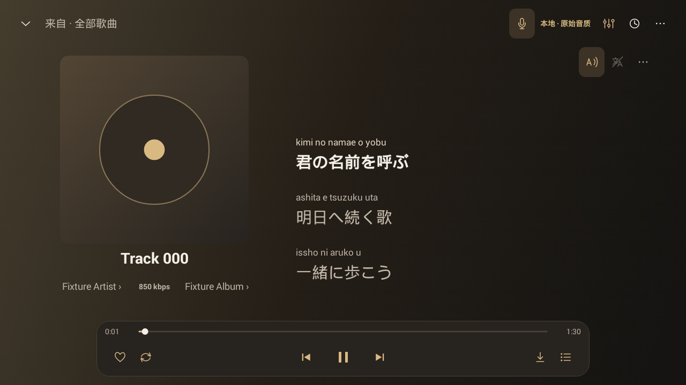

# NoMusic 0.7.1 验证记录

日期：2026-11-25。此次调整 K 歌显示：保留普通播放页的封面、歌词区域和字号，在原文上方显示发音，译文仍在下方。单句循环从歌词菜单操作。

## 构建与兼容

CS11 / standard 调试包、测试包和正式包构建通过；CS11 debug、CS11 release、standard release Lint 均通过，无错误。正式版 versionCode 为 16，沿用已有签名，保留 Android 4.x 所需的 APK v1 签名。

API 16 运行检查发现 Kuromoji 使用的 `StandardCharsets.UTF_8` 只适用于 API 19+。现已在保留第三方许可的 `StringValueMapBuffer` 中改用 `Charset.forName("UTF-8")`；字典格式、读音与原文不变。发音仓库遇到缺少运行时类等链接错误时会返回可重试状态，避免工作线程导致应用崩溃。

## 运行验证

| 环境 / 检查 | 结果 | 记录 |
| --- | --- | --- |
| Android 4.4 / API 19，组件与发音 | 9 / 9 | [输出](test-results/0.7.1-api19-widgets-karaoke.txt) |
| Android 4.4 / API 19，原有集成 | 13 / 13 | [输出](test-results/0.7.1-api19-base.txt) |
| Android 4.4 / API 19，播放页与界面 | 19 / 19 | [输出](test-results/0.7.1-api19-ui.txt) |
| Android 4.1 / API 16，跟唱与发音专项 | 2 / 2 | [输出](test-results/0.7.1-api16-karaoke.txt) |
| 已安装 CS11 正式包，版本、账号和队列恢复 | 1 / 1 | [输出](test-results/0.7.1-api19-installed-release.txt) |

共 44 项通过。测试使用本地 fixture，原有组件继续添加在 API 19 的桌面中。

界面用例确认开启 / 关闭 K 歌使用同一个歌词视图，封面持续可见，封面与歌词区域坐标不变，原文字号不变。发音行位于原文上方，译文显隐独立；旧的跟唱专用字号设置不影响当前原文。单句循环可从歌词菜单进入，退出 K 歌时清除循环，原有队列模式保持不变。

另验证了普通播放歌词的空白过滤、原文符号保留、翻译显隐、长按定位和同步滚动。API 16 本轮仅执行两项跟唱专项，不代表全部旧功能回归。

0.7.0 的其他功能与限制见 [先前验证记录](VALIDATION-0.7.0.md)。发布入口为 [更新站](https://nomusic.losertree.de/) 与 [GitHub v0.7.1](https://github.com/losertree/NoMusic/releases/tag/v0.7.1)，两种安装包使用相同源码与原有发行签名。
