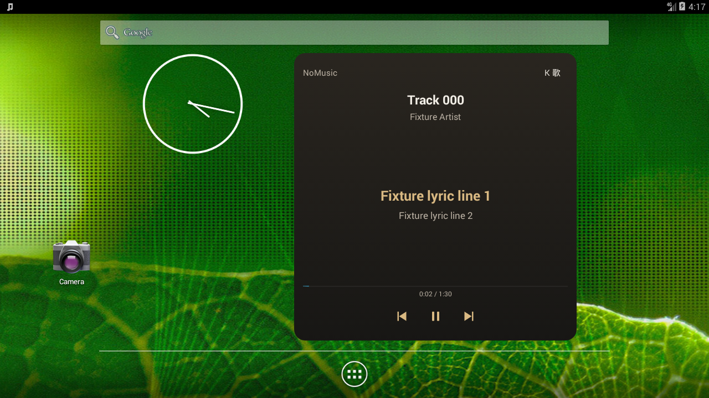
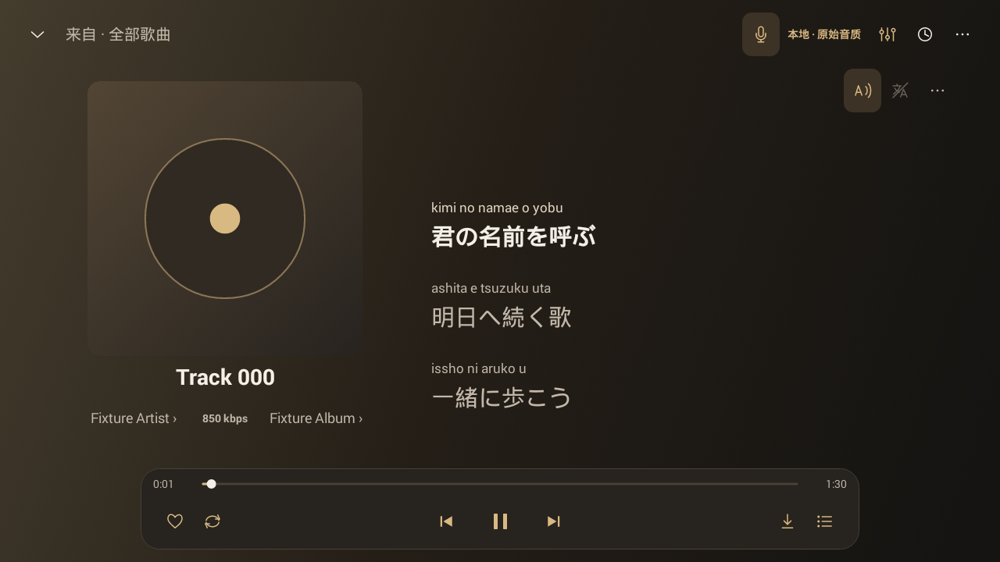

# 桌面组件与 K 歌跟唱（0.7.1）

## 桌面组件

长按桌面空白处 → 小部件 → NoMusic。有三种规格，可同时添加：



| 组件 | 内容 | 建议用途 |
| --- | --- | --- |
| 竖版歌词 | 封面、歌曲、前后句、当前歌词、发音、译文、进度和播放控制 | CS11：拖至约桌面宽度的三分之一，再拉满桌面可用高度 |
| 歌词卡片 | 小封面、当前歌词、发音、译文、播放控制 | 半高音乐卡片 |
| 播放控制条 | 歌曲、封面、播放 / 暂停、上下首 | 狭窄区域；缩小时收起上一首按钮 |

竖版和卡片可横纵调整，控制条可横向调整。Android 桌面按网格分配尺寸，应用无法指定跨所有固件都相同的三分之一比例或强占整高；竖版初始最小尺寸为 280 × 400 dp，可缩至 240 × 320 dp。卡片最小 280 × 240 dp，控制条最小 240 × 64 dp。缩小时优先保留当前歌词与控制，主动收起封面、前后句及次要辅助行，避免文字被遮挡。

点击封面、标题或歌词打开播放页，点击「K 歌」打开跟唱。上一首、播放 / 暂停、下一首直接控制同一个播放服务。按钮和当前歌词沿用所选主题色；开启「播放页跟随封面」时随封面取色。暂停保留当前歌词。组件不需要悬浮窗权限。

「设置 → 显示与歌词 → 组件发音辅助」控制组件的发音行，翻译沿用歌词翻译开关。原厂桌面需要提供标准 Android AppWidget 添加入口；没有这个入口的固件需要支持小部件的桌面，不能直接替换原厂私有音乐卡片。

## K 歌跟唱

播放页顶部麦克风图标切换 K 歌，也可从设置进入。开启后沿用原来的封面与歌词布局、歌词字号和滚动方式，只在每行原歌词上方添加发音，译文继续显示在原文下方。关闭后收起发音行。紧凑屏幕沿用已有的封面 / 歌词切换。



歌词上方的发音图标可以选择本曲的语言，并显示 / 隐藏发音。发音和翻译分别控制，不修改原始歌词。语言选择按 Emby 账号与歌曲保存：

| 语言 | 发音形式 | 实现 |
| --- | --- | --- |
| 粤语 | 粤拼，数字 1–6 表示声调 | 本地 CanCLID 粤拼词库，词组优先，支持简繁体；约 19.6 万条字词 |
| 日语 | 罗马音 | 本地 Kuromoji / IPADIC 分词，读取汉字词组读音，处理助词、拗音、促音和长音 |
| 韩语 | 罗马音 | 本地谚文分解，处理常见连音、鼻音化、流音和送气等规则 |
| 自动 | 根据假名或谚文选择日语 / 韩语 | 只有汉字时保留原文，提示手动选粤语或日语，不把普通话歌词自动转成粤语 |

有逐词时间信息时，原文逐词高亮，发音按照对应字或词的范围跟随高亮。普通 LRC 只提供逐句同步；纯文本可以浏览和查看发音，无法生成真实时间轴。自动转写遇到多音字、人名、特殊唱法时仍可能与原唱不同。

开启 K 歌后，歌词 ⋯ →「循环练习当前句」可从该句时间点到下一个时间点循环，应用本地歌词偏移；空白时间点仍作为间奏边界。同一菜单可关闭循环。长按其他歌词可跳转并退出循环。退出跟唱、离开播放页、重新选曲、停止或切换账号会清除练习循环，原先的随机 / 列表循环设置不变。暂停后可继续同一句。

本版本范围是跟唱、发音辅助和单句练习。

## 缓存与性能

组件复用现有歌词仓库，多个界面共享请求和磁盘缓存。没有额外的 Emby 歌词接口或轮询请求；组件更新使用播放服务已有的时钟。每秒最多更新一次进度与歌词，状态变化即时刷新。完整更新携带最长边 192 px 的独立封面副本；进度更新使用 RemoteViews 局部更新，不反复传输封面。没有组件时不读取组件歌词或生成发音。

发音完全在本机生成，不上传歌词。首次使用才加载对应词典，处理放在单个后台工作线程。发音结果按账号、歌曲、原文内容、语言和算法版本缓存；同一请求合并，切歌或退出时取消旧页面回调。缓存预算为 8 MB / 256 首，内存结果预算 768 KB，词典用软引用在内存紧张时释放。改变本地歌词或语言会生成新的缓存键，重开页面及重启可复用磁盘结果。

## 构建与验证

词典随 APK 分发，运行时无须下载。重建粤拼资产：`python tools/prepare_pronunciation.py`，脚本固定上游版本。词库及第三方代码许可见 [第三方说明](../THIRD_PARTY_NOTICES.md)。

```powershell
./tools/test.ps1 -Serial emulator-5556 -Flavor cs11 -Adb D:/Android/Sdk/platform-tools/adb.exe -WidgetsKaraoke
./tools/test.ps1 -Serial emulator-5556 -Flavor cs11 -Adb D:/Android/Sdk/platform-tools/adb.exe -Ui
```

验证范围与结果见 [0.7.1 验证记录](VALIDATION-0.7.1.md)。
